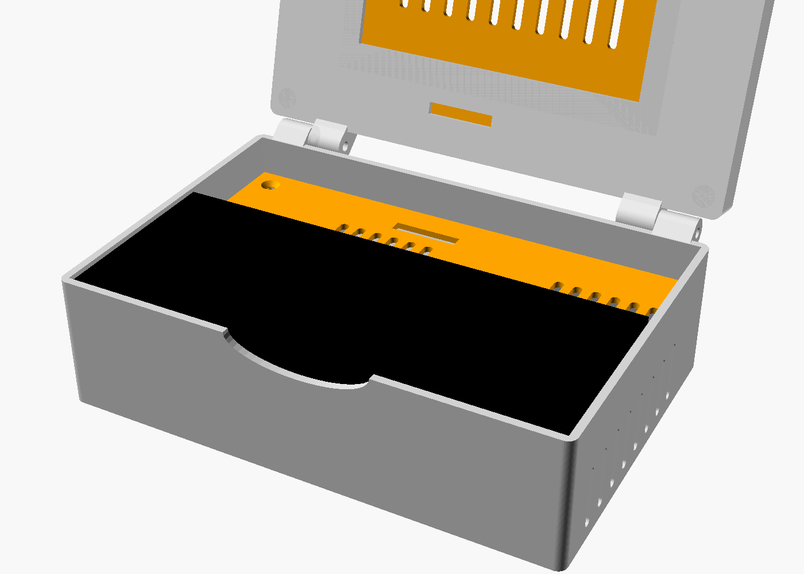

# Корпус Cyberdeck (Raspberry Pi 4 + Waveshare 4,3" DSI + Rii mini X1)

Раскладушка 158 × 106 мм, высота в закрытом виде ~54 мм.



## Детали для печати

| Файл | Что это | Как печатать |
|---|---|---|
| `base.stl` | нижний корпус | дном на стол, без поддержек |
| `deck.stl` | полка под клавиатуру | плоско, без поддержек |
| `lid.stl` | крышка с окном под экран | лицевой стороной на стол, поддержки только под петлями |
| `lid_cover.stl` | задняя крышка экрана | плоско |

Пластик — PETG (PLA может размягчиться от тепла Pi). Слой 0,2, стенки 3 периметра, заполнение 20 %.

## Что внутри

- Pi 4 лежит в середине, USB/Ethernet выходят в заднюю стенку.
- Справа пауэрбанк 100 × 40 мм, его разъём — в вырез на задней стенке (зарядка снаружи).
- Между Pi и пауэрбанком 16 мм под угловой USB-C кабель (Pi питается от пауэрбанка).
- Слева место под вентилятор 25 мм (выдув через левую стенку) и запас DSI-шлейфа.
- Над электроникой — полка, на ней лежит клавиатура, её можно вынуть за вырез спереди.
- DSI-шлейф идёт через щель в полке и в крышке (нужен 15-pin FFC ~20 см).

## Крепёж

- 4 × M2.5 саморез — Pi на стойки
- 2 × M3 × 6 потай — полка
- 4 × M3 × 8 потай — задняя крышка экрана
- 2 × M3 × 25 + гайки — петли (затянуть так, чтобы экран держал угол)
- 4 резиновые ножки снизу — под дном вентиляционные щели

## Перед печатью — измерить штангенциркулем

Все размеры в начале `cyberdeck_case.scad`: толщина пауэрбанка `pb`, клавиатура `kb`,
экран `scr_board` / `scr_view`, место разъёма пауэрбанка. После правки:

```bash
openscad -D 'part="base"' -o base.stl cyberdeck_case.scad
```
