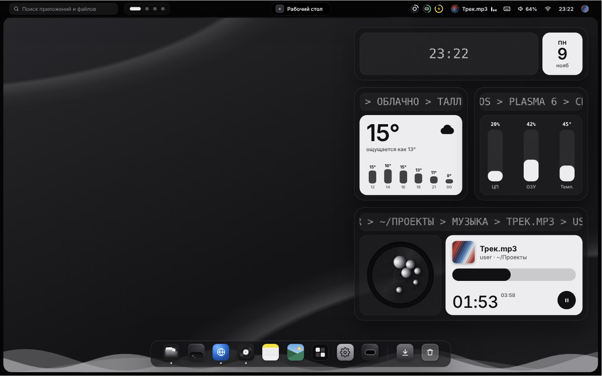
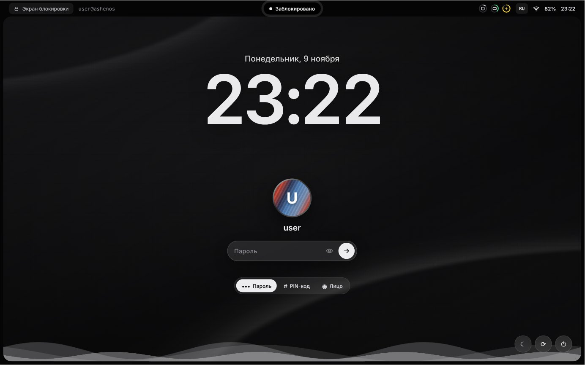
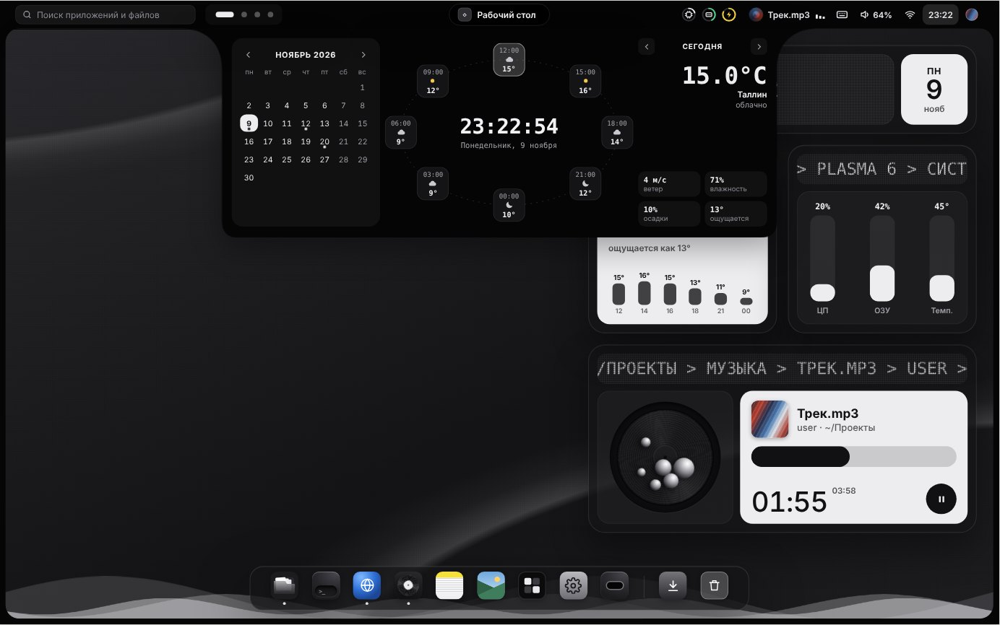
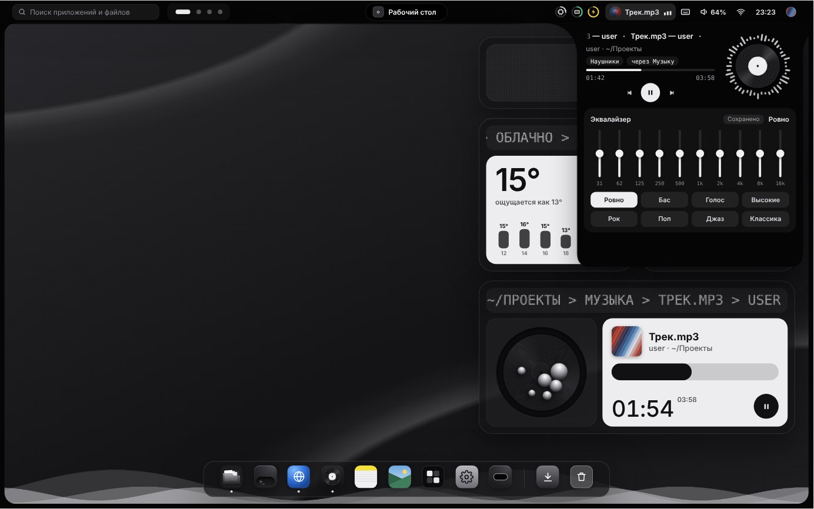
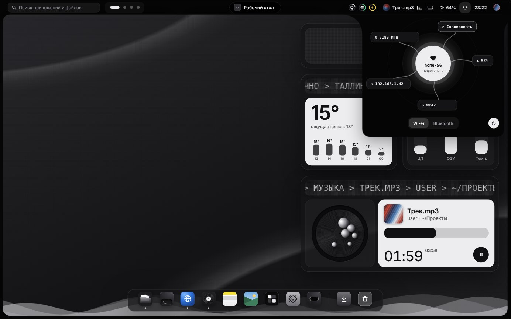
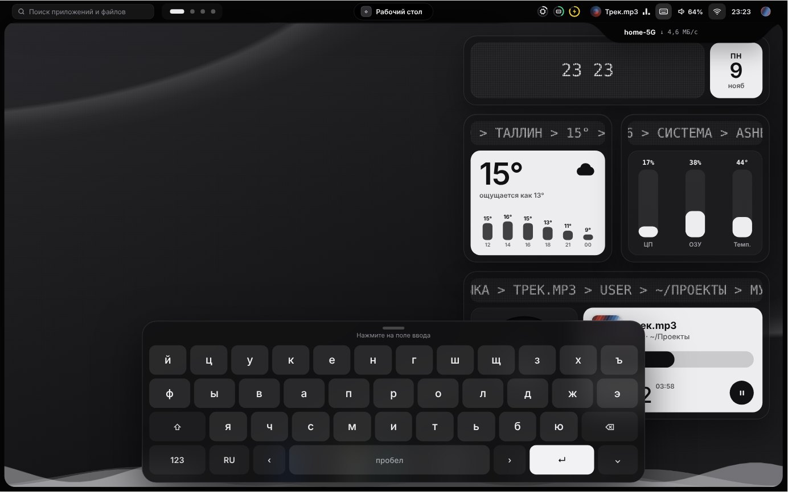
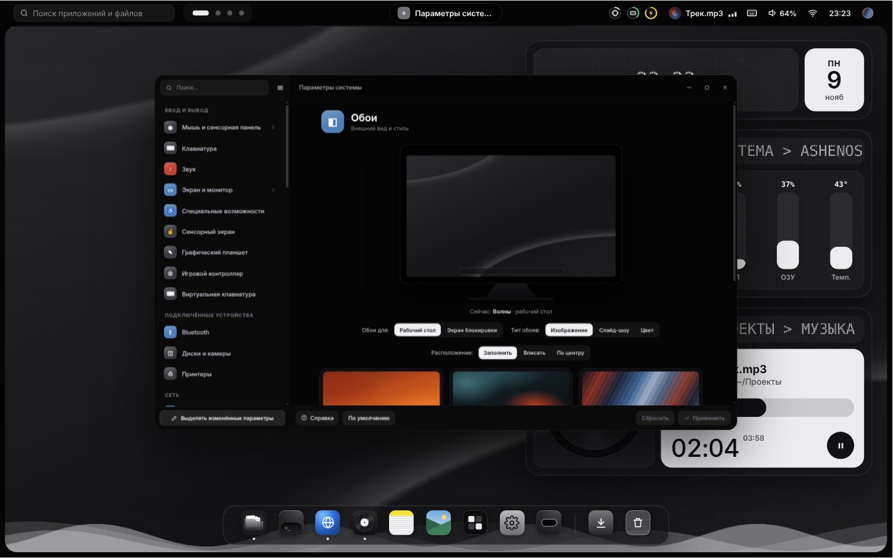
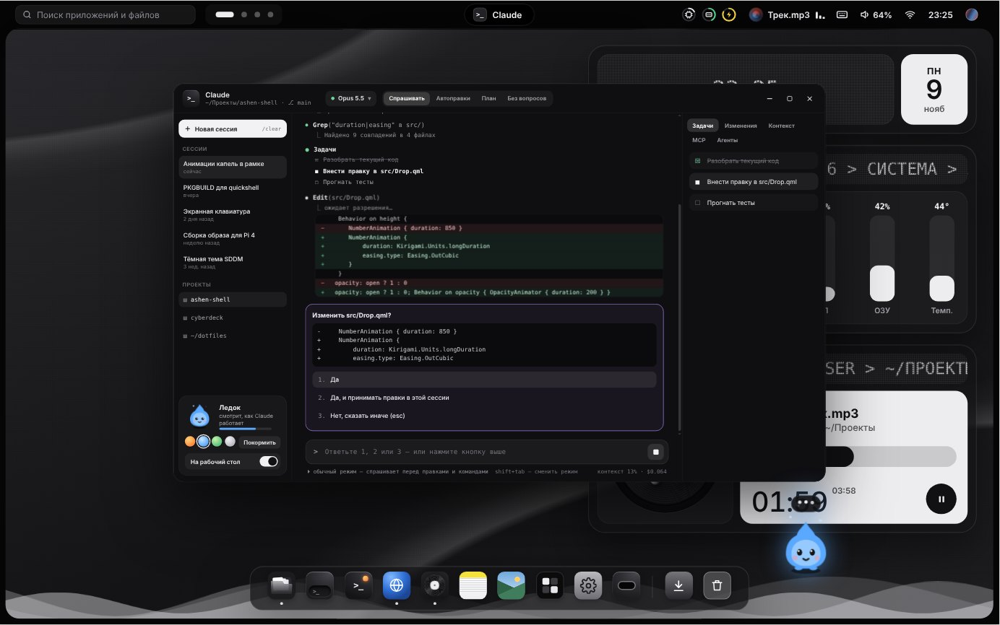
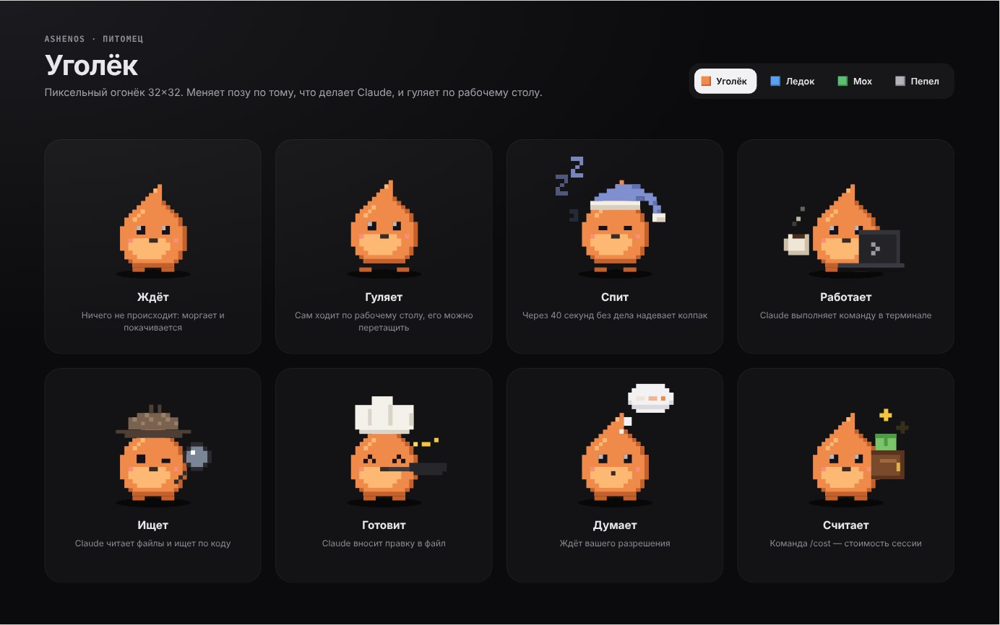
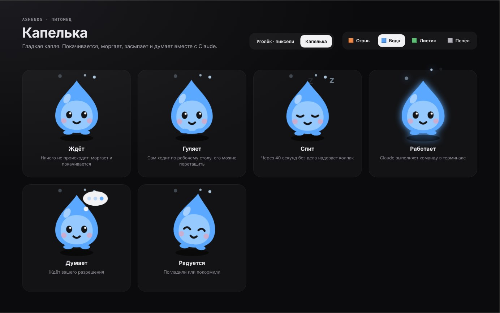

# AshenOS

**AshenOS** — дистрибутив на базе **Arch Linux ARM** для кибердека на Raspberry Pi 4
(экран Waveshare 4,3" DSI 800×480, клавиатура Rii mini X1). Чёрная тема, Plasma 6 на Wayland,
своя оболочка с «жидкими» панелями из рамки, Dynamic Island и экранной клавиатурой.



## Что внутри

| | |
|---|---|
| База | Arch Linux ARM (aarch64), ядро `linux-rpi` |
| Окружение | KDE Plasma 6, Wayland, KWin, SDDM |
| Тема | цветовая схема `AshenOS` (чёрная), Breeze Dark, шрифты Inter и JetBrains Mono |
| Анимации | как в Plasma: попапы выезжают из панели за 200 мс (OutCubic), списки раскрываются за 100 мс |
| Ввод | экранная клавиатура (Maliit на рабочем столе, Qt Virtual Keyboard на экране входа) |
| Экран | оверлей `vc4-kms-dsi-waveshare-800x480`, автоопределение выключено |
| Сеть | NetworkManager, Bluetooth (bluez), SSH, WayVNC |
| Терминал | Konsole + `claude` (Claude Code) из npm, приложение-оболочка «Claude» с питомцем |
| Claude | приложение [claude-desk](apps/claude-desk): Claude Code в окне, скиллы, агенты, история |

## Скриншоты концепта оболочки

| | |
|---|---|
|  Экран блокировки: пароль, PIN-код или лицо |  Календарь и погода из рамки |
|  Плеер с эквалайзером |  Wi-Fi и Bluetooth |
|  Экранная клавиатура |  Параметры системы |
|  Claude — оболочка над `claude` в терминале |  Пиксельный питомец Уголёк: ждёт, гуляет, спит, работает, ищет, готовит, думает, считает |
|  Второй питомец — Капелька (выбирается в приложении Claude) | |

Исходники интерактивного прототипа лежат в [`design/prototype`](design/prototype)
(`System.dc.html` — вся система: блокировка → рабочий стол → окна). Это макет интерфейса,
он открывается в Claude Design, а не напрямую в браузере.

Анимации попапов календаря, музыки и сети в прототипе повторяют тайминги и кривые из [`shell/animations`](shell/animations) (serpantinum, AGPL-3.0).


## Документы

- [Что готово](docs/STATUS.md) — что есть в прототипе, что уже в образе, что проверено на железе
- [Проверка на железе](docs/HARDWARE-CHECKLIST.md) — чек-лист первого запуска на Raspberry Pi
- **Динамический остров** — `airootfs/usr/share/ashenos/island/shell.qml` (Quickshell), запускается вместе с Plasma.
  Показывает музыку, громкость, батарею и таймер; на него можно перетащить файл из Dolphin и потом
  вытащить обратно. Из терминала: `quickshell ipc -p /usr/share/ashenos/island/shell.qml call island timer 25`
- Тема значков **Ashen** — `airootfs/usr/share/icons/ashen`, включена по умолчанию в `kdeglobals`;
  исходные картинки в `design/icons`

## Структура

```
ashenos/
├── build/
│   ├── build-image.sh   сборка .img для SD-карты
│   ├── packages.txt     список пакетов
│   └── ashenos-info     команда: версия, ядро, температура
├── apps/claude-desk/     приложение Claude (Quickshell) + install.sh
├── shell/animations/    попапы календаря, Wi-Fi, Bluetooth и музыки для будущей оболочки
├── airootfs/            файлы, которые накладываются на систему
│   ├── etc/os-release, hostname, motd, issue
│   ├── etc/sddm.conf.d/ashenos.conf
│   ├── etc/xdg/kdeglobals, kwinrc
│   ├── usr/share/color-schemes/AshenOS.colors
│   ├── usr/local/bin/claude-console   кнопка/команда запуска Claude
│   └── boot/config-ashenos.txt   дописывается в /boot/config.txt
└── design/              скриншоты и исходники прототипа
```

## Сборка образа

На компьютере с Arch Linux (x86_64):

```bash
sudo pacman -S --needed arch-install-scripts qemu-user-static-binfmt dosfstools parted wget
cd ashenos/build
sudo ./build-image.sh 8G
sudo dd if=out/ashenos-rpi4-*.img of=/dev/sdX bs=4M status=progress conv=fsync
```

Скрипт скачивает Arch Linux ARM для Pi 4, размечает образ (boot 512 МБ + root ext4),
накладывает `airootfs`, ставит пакеты и приложение Claude через qemu-chroot и включает `sddm`,
`NetworkManager`, `bluetooth`, `sshd`. Разделы монтируются по меткам (`ASHEN_BOOT`, `ashenos`). Пользователь по умолчанию — `alarm` / `alarm` (смените пароль после первого входа).

## Установка поверх уже работающего Arch Linux ARM

```bash
git clone https://github.com/kkostyy/cyberdeck && cd cyberdeck/ashenos
sudo pacman -Syu --needed $(grep -v '^\s*#' build/packages.txt | grep -v '^\s*$')
sudo cp -r airootfs/etc airootfs/usr /
sudo sh -c 'cat airootfs/boot/config-ashenos.txt >> /boot/config.txt'
sudo install -Dm755 build/ashenos-info /usr/local/bin/ashenos-info
apps/claude-desk/install.sh          # приложение Claude для текущего пользователя
sudo systemctl enable --now sddm NetworkManager bluetooth
```

После перезагрузки в «Параметры системы → Оформление → Цвета» выберите схему **AshenOS**.

## Статус

- [x] Концепт оболочки: рамка, Dynamic Island, капли-панели, виджеты, док, экран блокировки
- [x] Цветовая схема, конфиги SDDM/KWin, оверлей экрана
- [x] Скрипт сборки образа
- [x] Приложение Claude (claude-desk) в образе
- [ ] Перенос оболочки из прототипа в Quickshell/QML (заготовки анимаций — в `shell/animations`)
- [ ] Свой экран входа SDDM в стиле прототипа

## Автонастройка на Raspberry Pi

После записи образа на карту на разделе `ASHEN_BOOT` лежит **`ashenos.conf`** — его можно открыть на любом компьютере и до первой загрузки вписать имя устройства, пользователя и пароль, Wi‑Fi, часовой пояс, язык, раскладки, SSH/VNC, тему и оттенок.

При первом запуске `ashenos-firstboot.service` (до экрана входа):
- растягивает корневой раздел на всю карту;
- задаёт имя, часовой пояс, язык, раскладки (Alt+Shift), страну Wi‑Fi;
- переименовывает пользователя `alarm`, ставит пароль, добавляет в группы `video audio input i2c gpio`;
- подключает Wi‑Fi через NetworkManager, включает SSH/VNC;
- переименовывает файл в `ashenos.conf.done` и стирает из него пароли.

При каждом входе в Plasma `ashenos-settings apply --once` применяет все «Параметры» (если они изменились): цветовую схему из 18 тем прототипа с оттенком и окраской фона, обои (в том числе экрана блокировки), шрифты, раскладки и экранную клавиатуру Maliit, масштаб и поворот экрана, ночную цветовую схему, громкость, «Не беспокоить» и время показа уведомлений, скорость анимаций, автоблокировку, Wi‑Fi и Bluetooth.

```sh
ashenos-settings                 # окно «Параметры AshenOS» (есть и в меню приложений)
ashenos-settings list            # все настройки
ashenos-settings set THEME gruvbox
ashenos-settings set ACCENT orange   # или #ff8a3d
ashenos-settings set NIGHT always
ashenos-settings reset
```

Значения по умолчанию — `/etc/ashenos/settings.conf`, свои — `~/.config/ashenos/settings.conf`.

## Окна как в macOS (прототип)

Кнопки «светофор» справа в заголовке (закрыть / свернуть / во весь экран, значки появляются при наведении), окно приподнимается при перетаскивании, у верхнего края появляется превью «во весь экран», двойной щелчок по заголовку разворачивает окно, сворачивание — эффект «джинна».

## Карты (ashen-maps)

`apps/ashen-maps/main.qml` — приложение карт на QtLocation: OpenStreetMap с тёмными плитками, поиск адресов (Nominatim), маршруты авто / пешком / вело (OSRM), GPS через QtPositioning (geoclue2 или gpsd с USB/UART-приёмником). Просмотренные участки кэшируются (до 512 МБ) и открываются без сети; готовые офлайн-плитки можно положить в `~/.local/share/ashen-maps/tiles`.

```sh
ashen-maps                              # или «Карты» в меню приложений
ashenos-settings set MAPS_STYLE light   # светлая карта
```

Поиск и маршруты требуют интернета. Слой Google Maps пока не подключён (ключ `MAPS_GOOGLE_KEY` — задел). Приложение ещё не проверялось на самой Pi.
