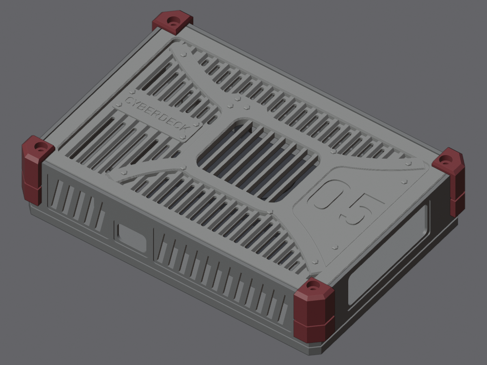

# Верхняя часть (своя версия, SketchUp)

Это корпус экрана: коробка 160 × 110 × 35 мм и задняя рамка к ней. Сделан на основе своей модели
из SketchUp. Экран Waveshare 4,3" DSI стоит в окне лицевой панели, Raspberry Pi 4B прикручен
к его обратной стороне. На Pi стоит радиатор GeeekPi Armor Lite с вентилятором, он смотрит в рамку.

## Последние модели

| Файл | Что это |
|---|---|
| `5 стиль v3 - крышка.stl` | коробка: крепление экрана, окна под USB/Ethernet и USB-C, наклонные прорези продува, линия разъёма, 4 стойки Ø9 под вплавляемые гайки |
| `5 стиль v3 - рамка.stl` | задняя рамка: гофра как у контейнера с прорезями во впадинах, окно с рёбрами над вентилятором, к нему сходятся кривые X-ремни; табличка «05», шильдик CYBERDECK |
| `5 стиль v3 - угол.stl` | угол-бампер, печатать 4 шт. Его держит винт рамки |
| `5 стиль v3.skp` | сборка в SketchUp 2017: крышка, рамка и углы отдельными группами |
| `proba v4.stl` / `.skp` | тестовая деталь: карман под экран 106,5 × 68,5 и 4 стойки |

Крышка и угол в v3 те же, что в v2. Изменилась только рамка.

## Радиатор Pi

GeeekPi Armor Lite (ZP-0110) для Pi 4B: радиатор с вентилятором 3510. Он крепится двумя винтами M2.5,
вентилятор питается от GPIO (5V, GND, GPIO14). Окно в рамке 46 × 38 мм стоит над вентилятором,
между рёбрами щели по 4.2 мм. Радиатор проходит под рамкой с зазором 2.6 мм. Над разъёмами вентилятора
на GPIO в рамке снизу сделан карман, чтобы провода было куда загнуть. Высота радиатора (14 мм от платы)
взята по фото и пока не замерена: параметр `HS_H` в `src/style.py`.

## Крепёж

На каждый угол нужен 1 винт M3×8 DIN 912 (цилиндрическая шляпка под шестигранник) и 1 вплавляемая гайка M3×4×5.
Винт проходит через угол-бампер и рамку в гайку, вплавленную в стойку крышки. Отверстие под гайку
Ø4.2 глубиной 6 мм. Шляпка утоплена в бампер на 0.3 мм. Если гайки другого размера, отверстие
меняется параметрами `INSERT_*` в `src/style.py`.

Стенки (вид со стороны рамки): 1 — левая короткая, 2 — правая короткая (USB + Ethernet),
3 — нижняя длинная (USB-C), 4 — верхняя длинная.

В `архив` лежат прошлые версии. Скрипты, которые собирают модели, и команды пересборки — в [src/README.md](src/README.md).
